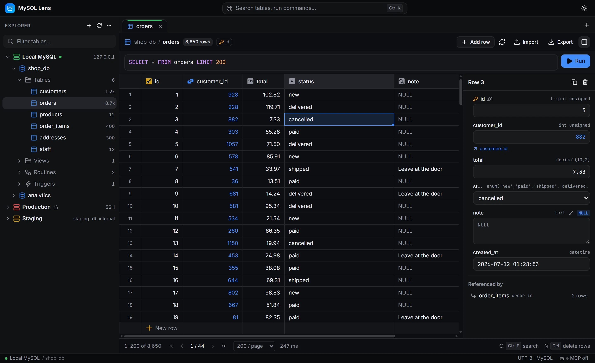
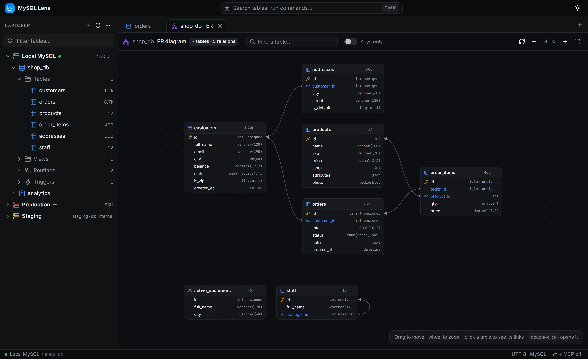
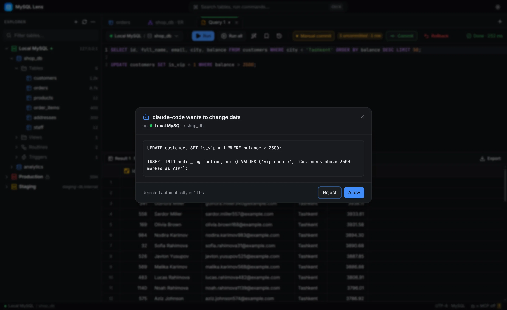

# MySQL Lens

**A fast, free MySQL and MariaDB client for Windows.** Edit data like a spreadsheet, follow foreign keys, see your schema as an ER diagram, run changes in a safe transaction — and let AI assistants work with your databases, with your approval for every change.

[**Website**](https://lens.azizdevfull.uz) · [**Download**](https://github.com/azizdevfull/mysql-lens/releases/latest) · [VS Code extension](https://marketplace.visualstudio.com/items?itemName=azizdevfull.mysql-lens)

```powershell
irm https://raw.githubusercontent.com/azizdevfull/mysql-lens/main/install.ps1 | iex
```



## Features

- **Editable data grid.** Edit cells, add and delete rows, paste from Excel. Changes are shown as SQL and saved in one transaction.
- **Foreign key navigation.** Ctrl+click a foreign key value to open the row it points at; the row panel lists the tables that point back, with counts.
- **ER diagram.** Tables, columns and relations of a database; drag, zoom, click a table to highlight its links.
- **Manual commit mode.** Run statements in one transaction, then Commit or Rollback. The toolbar shows what is not committed yet.
- **AI access (MCP).** Claude Code, Cursor, VS Code or Claude Desktop can use the connections you allow; every write waits for your approval.
- **SQL editor.** Autocomplete, formatting (`Shift+Alt+F`), saved queries (`Ctrl+S`), searchable history (`Ctrl+H`).
- **JSON and BLOB editor.** JSON is formatted and validated, images in BLOBs are previewed, other binary data is shown as hex.
- **Import and export.** CSV, Excel, JSON, SQL dumps, with progress for large tables.
- **Safety.** Red (production) connections confirm every write; `UPDATE`/`DELETE` without `WHERE`, `DROP` and `TRUNCATE` always ask.
- **Connections.** Unlimited, with SSH tunnels and SSL; passwords stay in the Windows Credential Manager.
- **Small and native.** Tauri + Rust, a 4 MB installer that updates itself.

| ER diagram | AI asks before changing data |
|---|---|
|  |  |

## Install

Requires 64-bit Windows 10 or 11. The installer is per-user, so no administrator rights are needed.

**One command (recommended).** In PowerShell:

```powershell
irm https://raw.githubusercontent.com/azizdevfull/mysql-lens/main/install.ps1 | iex
```

Or in cmd:

```bat
powershell -NoProfile -ExecutionPolicy Bypass -Command "irm https://raw.githubusercontent.com/azizdevfull/mysql-lens/main/install.ps1 | iex"
```

The script downloads the latest installer from [GitHub Releases](https://github.com/azizdevfull/mysql-lens/releases/latest), installs it silently and removes the downloaded file. Close MySQL Lens before running it.

**A specific version:**

```powershell
$env:MYSQL_LENS_VERSION = '0.6.0'; irm https://raw.githubusercontent.com/azizdevfull/mysql-lens/main/install.ps1 | iex
```

**Manual install.** Download `MySQL-Lens_<version>_x64-setup.exe` from [Releases](https://github.com/azizdevfull/mysql-lens/releases/latest) and run it. The app is not code-signed yet, so Windows SmartScreen may show a warning: click **More info → Run anyway**.

**Updates.** The app checks for new versions on startup and installs them with one click. Running the install command again also updates to the latest version.

**Uninstall.** Settings → Apps → Installed apps → MySQL Lens → Uninstall.

## AI access (MCP)

The Windows app can let AI assistants (Claude Code, Cursor, VS Code, Claude Desktop) use your saved connections through the [Model Context Protocol](https://modelcontextprotocol.io). It is off by default.

1. Open **AI access (MCP)** from the status bar or `Ctrl+K`, and turn the server on.
2. Choose per connection: **Off**, **Read only**, or **Read & write**. Production (red) connections start as off.
3. Copy the configuration for your assistant. For Claude Code:

   ```bash
   claude mcp add --transport http mysql-lens http://127.0.0.1:7421/mcp --header "Authorization: Bearer <token from the app>"
   ```

What the assistant can do: list connections, databases and tables, describe a table (columns, indexes, foreign keys), run read queries, and run changes.

How it is kept safe:

- The server listens on `127.0.0.1` only and needs the token shown in the app.
- Read queries run inside a read-only transaction, so MySQL itself refuses any change, and results are limited (200 rows and 30 seconds by default).
- Every change (`INSERT`, `UPDATE`, `DELETE`, DDL) opens a window in MySQL Lens showing the SQL; it runs only if you press **Allow**, and is rejected after 2 minutes without an answer.
- Every request appears in the query history (`Ctrl+H`) marked with the assistant's name.

## VS Code extension

MySQL Lens is also a VS Code extension (any OS) with the data grid, SQL editor and import/export:

```bash
code --install-extension azizdevfull.mysql-lens
```

See [README.vscode.md](README.vscode.md) for its features, shortcuts and settings.

## Development

- Windows app (`app/`, Tauri + Rust + React): `cd app && npm install && npm run dev` runs the UI with demo data in a browser; `npx tauri dev` runs the desktop app; `cargo test -p lens-core` runs the Rust tests.
- VS Code extension (repository root): `npm install`, `npm run watch`, then press F5 in VS Code; `npm run package` builds the `.vsix`.

## Privacy

MySQL Lens does not collect or send any data about you or your databases. It connects only to:

- the MySQL/MariaDB servers and SSH hosts you configure;
- GitHub (`github.com`), to check for and download new versions of the Windows app.

Connections are stored on your computer (`%APPDATA%\uz.azizdev.mysqllens`). Passwords are kept in the Windows Credential Manager. Query history, saved queries and open tabs stay in the same local folder.

## Code signing policy

The Windows installer is not code-signed yet, so Windows SmartScreen or Smart App Control may warn before installing it.

Windows releases are built from this repository by [GitHub Actions](.github/workflows/app.yml); nothing is built or uploaded by hand. Once code signing is set up, only the installer produced by that workflow from a release tag (`app-v*`) will be signed, and every signing request will be approved by hand.

Team roles:

- Authors (committers): [Azizbek Isroilov](https://github.com/azizdevfull)
- Reviewers: [Azizbek Isroilov](https://github.com/azizdevfull) (changes from other contributors are reviewed before they are merged)
- Approvers: [Azizbek Isroilov](https://github.com/azizdevfull)

Privacy policy: see [Privacy](#privacy). The only connection the app makes on its own is the update check to GitHub; it sends no data about you or your databases.

## License

MIT
